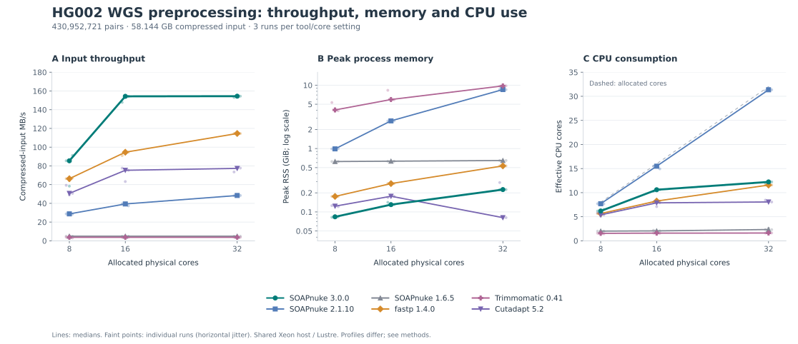

# SOAPnuke 3.0.0

SOAPnuke processes short-read FASTQ data with a Rust core and native compression libraries. It provides five commands and an owned Rust library.

**Explore the [interactive visual guide](https://bgi-flexlab.github.io/SOAPnuke3/)** to see each processing step, adjust examples, and inspect option behavior. For offline use, [download the guide ZIP](https://bgi-flexlab.github.io/SOAPnuke3/SOAPnuke-guide.zip), extract it, and open `index.html`. The same files are in [`docs/interactive/`](docs/interactive/).

| Command | Purpose |
|---|---|
| `process` | Trim and filter single or paired reads; inspect references; correct or merge mates; produce QC. |
| `demux` | Route reads to samples using inline, index, or declared tag barcodes. |
| `dedup` | Group complete sequences and retain the earliest representative in input order. |
| `report` | Render saved reports as HTML/TSV or create supported named exports. |
| `resources` | List, show, or verify explicitly supplied local adapter/reference catalogues. |

This repository is separate from [SOAPnuke v1/v2](https://github.com/BGI-flexlab/SOAPnuke). Interfaces, defaults and supported workflows differ; see the [migration guide](docs/MIGRATION.md).

## Install or build

Choose the download matching `uname -m`:

| Linux machine | Download |
|---|---|
| `x86_64` (Intel/AMD) | [Linux x86-64 executable](https://github.com/BGI-flexlab/SOAPnuke3/releases/download/v3.0.0/SOAPnuke-3.0.0-linux-x86_64.tar.gz) |
| `aarch64` (ARM64 server) | [Linux ARM64 executable](https://github.com/BGI-flexlab/SOAPnuke3/releases/download/v3.0.0/SOAPnuke-3.0.0-linux-aarch64.tar.gz) |

Extract the archive and run `./bin/SOAPnuke --version` inside it. Checksums are on the [release page](https://github.com/BGI-flexlab/SOAPnuke3/releases/tag/v3.0.0). The ARM64 download is tested natively on Ubuntu 24.04 and requires **glibc 2.39+** plus the C++ runtime and zlib. Build from source on older Linux systems. Linux ARM64 is not a macOS or 32-bit ARM build.

For source builds, use Rust/Cargo 1.99.1, C, C++17, CMake, Make and zlib development headers. Python 3.10+ is needed for build identity and tests. A minimum Rust version has not been established. Locked Rust dependencies, libdeflate and rapidgzip sources are included; Cargo downloads and submodule initialization are unnecessary. Follow the [step-by-step Linux ARM64 instructions](docs/BUILDING.md#linux-arm64-source-build), or use the same native build commands on Linux x86-64:

```sh
make JOBS=2
./target/release/SOAPnuke --version
export PATH="$PWD/target/release:$PATH"
```

See [building and tests](docs/BUILDING.md). Build jobs and processing threads are separate settings. Portable or byte-identical binary rebuilds are not promised.

**Conda packages are available for Linux x86-64 and ARM64:** follow the [installation instructions](docs/BUILDING.md#install-with-conda). The package is named `soapnuke3` and installs the command `SOAPnuke`. [Bioconda submission](https://github.com/bioconda/bioconda-recipes/pull/71175) is awaiting review; the package is not yet available from that channel. The same guide includes [building the Conda packages from source](docs/BUILDING.md#conda-package-builds).

## Quick start

Create an output directory and supply your reads:

```sh
mkdir clean-output
SOAPnuke process -1 reads_R1.fq.gz -2 reads_R2.fq.gz \
  -C clean_R1.fq.gz -D clean_R2.fq.gz -o clean-output -T 16 \
  -l 20 -q 0.5 -n 0.05 -4 30 --html-report sample.qc.html
```

The JSON report is `clean-output/SOAPnuke.json`. These thresholds are examples, not universal sequencing recommendations. Adapters are trimmed only when supplied or inferred. Existing outputs are not overwritten. For authored sample data, see [examples](examples/README.md). Run `SOAPnuke COMMAND --help` for grouped options, defaults and examples.

## Important behavior

- Filters are off until enabled; minimum read length is one base. Input and output quality encoding default to Phred+33.
- Low quality means **Q < cutoff**. A read fails a fraction limit only when **fraction > limit**; equality passes.
- Canonical A/C/G/T overlap and reference matching is case-insensitive. Read spelling and numeric qualities remain unchanged unless an enabled transformation changes them. N/IUPAC are not wildcards.
- Adapter FASTA accepts A/C/G/T in either case. Reference FASTA retains its IUPAC alphabet, but only canonical windows match.
- Paired-end `--adapter-overlap` is optional and off by default. It requires supplied 3′ adapters for both mates and a unique, supported overlap. See [adapter and processing rules](docs/USAGE.md).
- A resource catalogue is optional for direct adapter/reference paths. `id:ID` and the `resources` actions require an explicit catalogue. Nothing is downloaded or selected implicitly.
- `dedup` needs the full input and a scratch directory. Exact sequence equality is a computational duplicate definition, not molecular duplicate truth.

## HG002 whole-genome benchmark

We compared six tools on the complete **430,952,721-pair HG002 WGS dataset** (58.144 GB of compressed input, approximately 41.6× nominal depth), with three preprocessing runs at each of 8, 16 and 32 allocated physical cores.

At 32 cores, SOAPnuke 3.0.0 completed in **6.27 minutes**, compared with **8.46 minutes for fastp 1.4.0**: **25.8% less elapsed time**. Median peak RSS was **0.225 GiB**, compared with **0.533 GiB** for fastp. These are results for this dataset and the explicit profiles below.



Lines show three-run medians; faint points show individual observations. Throughput uses **compressed-input MB/s**. Memory uses a logarithmic axis; CPU is measured effective cores, not requested threads.

### Preprocessing at 32 cores

| Tool | Wall time (s) | CPU (%) | Peak RSS (GiB) | Input (MB/s) | Retained pairs |
| --- | --- | --- | --- | --- | --- |
| SOAPnuke 3.0.0 | 376.49 | 1,223.0 | 0.225 | 154.44 | 430,883,998 |
| SOAPnuke 2.1.10 | 1,201.45 | 3,135.4 | 8.530 | 48.39 | 430,883,993 |
| SOAPnuke 1.6.5 | 11,833.00 | 234.1 | 0.647 | 4.91 | 430,883,993 |
| fastp 1.4.0 | 507.37 | 1,157.6 | 0.533 | 114.60 | 430,889,028 |
| Trimmomatic 0.41 | 15,475.00 | 161.5 | 9.749 | 3.76 | 430,889,593 |
| Cutadapt 5.2 | 751.98 | 806.4 | 0.081 | 77.32 | 429,492,691 |

CPU 100% represents one effective core. Each metric is its own three-run median. See [all 18 cells and ranges](docs/benchmarks/hg002-wgs-20261105/RESULTS.md) and [all 54 observations](docs/benchmarks/hg002-wgs-20261105/data/preprocessing_54_observations.tsv).

SOAPnuke3, fastp, Trimmomatic and Cutadapt used gzip level 4; v1/v2 retained their historical native compression settings. Trimmomatic and Cutadapt performed quality-end trimming, while the SOAPnuke and fastp profiles used read filtering. Exact parameters and boundary differences are in the [methods](docs/benchmarks/hg002-wgs-20261105/METHODS.md).

### Downstream variant-calling accuracy

Retained paired reads entered a common BWA-MEM2 → GATK duplicate marking/BQSR → HaplotypeCaller → hard-filtering workflow. SNP and INDEL calls were evaluated with hap.py/RTG vcfeval against **GIAB HG002 GRCh38 v4.2.1** in the same confident regions.

| Tool | SNP precision (%) | SNP recall (%) | SNP F1 (%) | INDEL precision (%) | INDEL recall (%) | INDEL F1 (%) |
| --- | --- | --- | --- | --- | --- | --- |
| Cutadapt 5.2 | 99.6849 | 98.0568 | 98.8641 | 99.4418 | 99.0469 | 99.2440 |
| SOAPnuke 3.0.0 | 99.6876 | 98.0504 | 98.8622 | 99.4573 | 99.0279 | 99.2422 |
| SOAPnuke 1.6.5 | 99.6883 | 98.0510 | 98.8629 | 99.4559 | 99.0273 | 99.2411 |
| SOAPnuke 2.1.10 | 99.6875 | 98.0505 | 98.8622 | 99.4568 | 99.0277 | 99.2418 |
| fastp 1.4.0 | 99.6880 | 98.0505 | 98.8625 | 99.4562 | 99.0277 | 99.2415 |
| Trimmomatic 0.41 | 99.6879 | 98.0485 | 98.8614 | 99.4559 | 99.0300 | 99.2425 |

These results show closely similar observed calling accuracy on this sample. The differences are small and describe this single sample. [Download the accuracy table as SVG](docs/benchmarks/hg002-wgs-20261105/figures/variant_accuracy_table.svg). Formal SOAPnuke 3.0.0 and fastp 1.4.0 calling results were reused after both retained input mates were confirmed byte-identical to the already analyzed files.

All measurements used a shared dual-socket Xeon Gold 6442Y host and Lustre storage. CPU placement and measurement dates differ across campaign stages; cores were not exclusively reserved. See the [complete methods, commands and provenance](docs/benchmarks/hg002-wgs-20261105/METHODS.md) for the scope and reproducibility details.

## Documentation and validation

- [Process and algorithm guide](docs/USAGE.md), [Demux/Dedup/report guide](docs/JOBS.md), [Rust API](docs/API.md), [resources](docs/RESOURCES.md), [architecture](docs/ARCHITECTURE.md)
- [Build and test](docs/BUILDING.md), [dependency integration](docs/DEPENDENCY-INTEGRATION.md), [validation scope](docs/VALIDATION.md), [changes](CHANGELOG.md)
- Complete help: [process](docs/process-help.txt), [demux](docs/demux-help.txt), [dedup](docs/dedup-help.txt), [report](docs/report-help.txt), [resources](docs/resources-help.txt)

```sh
make test JOBS=2 TEST_THREADS=2
```

The maintained route runs native tests, portable CLI suites and owned-library examples. The separate WGS study above reports preprocessing measurements and downstream results for one explicit profile; it does not establish all-parameter or universal biological qualification. [Validation](docs/VALIDATION.md) documents the maintained test coverage, datasets and measured costs.

## License

See [COPYING](COPYING) and [third-party licenses](THIRD_PARTY.md). Report software problems through the repository issue tracker with the version, explicit options and a minimal shareable example.
